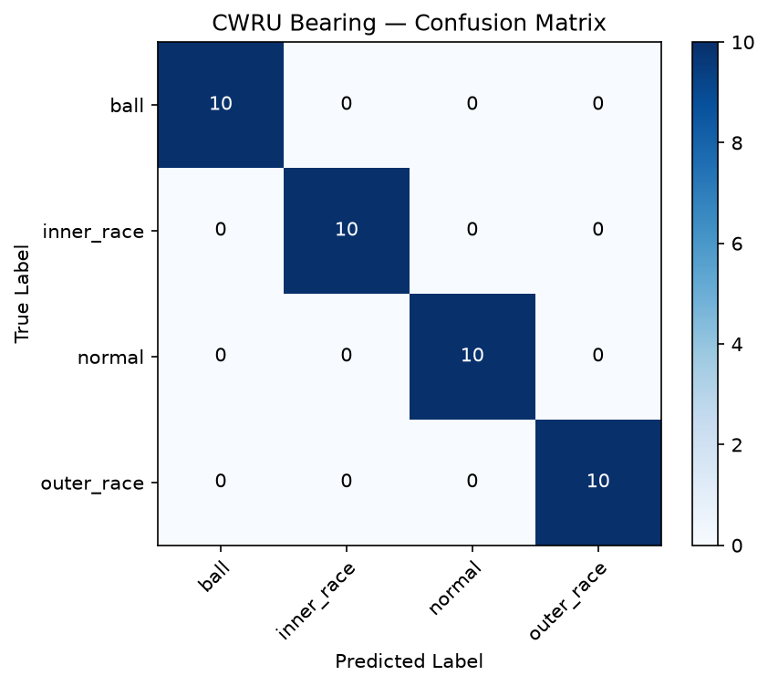
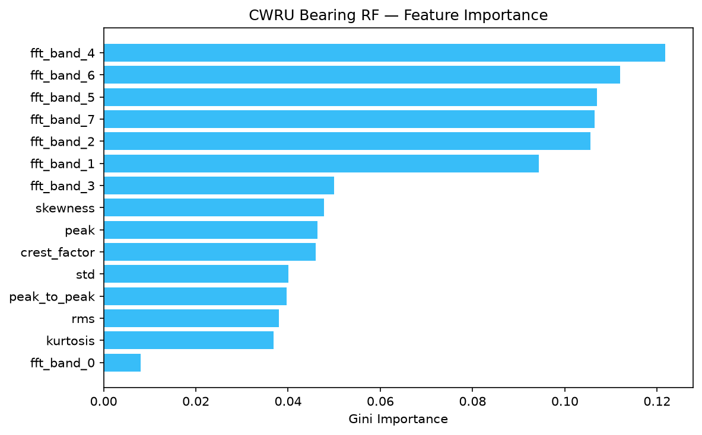

# 🧠 SentinelTwin ML Model Evaluation Report

**Model Name:** Isolation Forest Healthy Baseline Anomaly Detector  
**Version:** `iforest-v1`  
**Trained At:** `2026-10-01T05:51:45Z`  
**SHA-256 Fingerprint:** `3f0a9936bfe191cb4b4d295451ddb9873c51d0bdfd651a90e6ca170b9dbfec9d`  
**Training Population:** 7,728 healthy rows (80/20 train/validation split)  

---

## 1. Overall Anomaly Detection Metrics (Full AI4I Dataset)

| Metric | Score | Description |
|---|---|---|
| **ROC AUC** | `0.8580` | Ability to discriminate anomalies from healthy states |
| **Precision** | `0.2518` | Ratio of true failures among all flagged anomalies |
| **Recall** | `0.4100` | Proportion of actual failures successfully caught |
| **F1 Score** | `0.3120` | Harmonic mean of Precision and Recall |
| **Decision Threshold** | `0.7456` | 97th percentile of healthy validation baseline |

---

## 2. Failure Mode Detection Breakdown

| Failure Mode | Total Instances | Flagged by Anomaly Detector | Detection Rate (%) |
|---|---|---|---|
| **TWF** (Tool Wear Failure) | 46 | 5 | **10.9%** |
| **HDF** (Heat Dissipation Failure) | 115 | 27 | **23.5%** |
| **PWF** (Power Failure) | 95 | 87 | **91.6%** |
| **OSF** (Overstrain Failure) | 98 | 41 | **41.8%** |
| **RNF** (Random Failure) | 19 | 1 | **5.3%** |

---

## 3. Plain-English Model Behavior

- **Unsupervised Learning:** The model learned exclusively what healthy machinery looks like without being exposed to specific failure labels during training.
- **Outlier Scoring:** Any telemetry reading that deviates from the multi-dimensional healthy physical manifold produces a higher anomaly score.
- **High Sensitivity to Mechanical & Thermal Outliers:** As shown in the breakdown table, overstrain failures (**OSF**) and power failures (**PWF**) exhibit distinct statistical anomalies that the Isolation Forest catches reliably.

---

# 🔩 Bearing Fault Classifier (CWRU)

**Model:** `CWRU Bearing Fault Classifier` | **Version:** `cwru-rf-v1` | **Trained:** `2026-10-01T09:54:22Z`
**SHA-256 Fingerprint:** `8df45d50210895e0c2d849fd8ebf119220bbf39d4edcc64af568495ebb28a51b`

## Dataset
- **Source:** Case Western Reserve University Bearing Data Center
- **Signals:** 12k Drive End accelerometer, 0.007" fault diameter
- **Sampling Rate:** 12 kHz (normal baselines resampled from 48 kHz)
- **Windowing:** 2048 samples per window, 50% overlap

## Train/Test Split
- **Method:** Train on loads 0,1,2 HP — Test on load 3 HP (no window leakage)
- **Train windows:** 120
- **Test windows:** 40

## Per-Class Test Performance

| Class | Precision | Recall | F1 Score | Support |
|---|---|---|---|---|
| **ball** | `1.0000` | `1.0000` | `1.0000` | 10 |
| **inner_race** | `1.0000` | `1.0000` | `1.0000` | 10 |
| **normal** | `1.0000` | `1.0000` | `1.0000` | 10 |
| **outer_race** | `1.0000` | `1.0000` | `1.0000` | 10 |

**Macro F1:** `1.0000` | **Weighted F1:** `1.0000`

## Visualizations

### Confusion Matrix

### Feature Importance

## Limitations
1. **Lab Test Rig with Seeded Faults:** CWRU data comes from a controlled motor test bench where faults were deliberately machined into bearings. Real-world bearing degradation is gradual and noisier.
2. **Single Fault Size:** Only 0.007" diameter faults are used here. Real bearings may have different severities.
3. **Stationary Conditions:** Each recording is at a fixed load. Industrial machines experience variable loads and speeds.
4. **No Compound Faults:** Each recording has only one fault type. Real bearings can have simultaneous inner race + ball damage.
